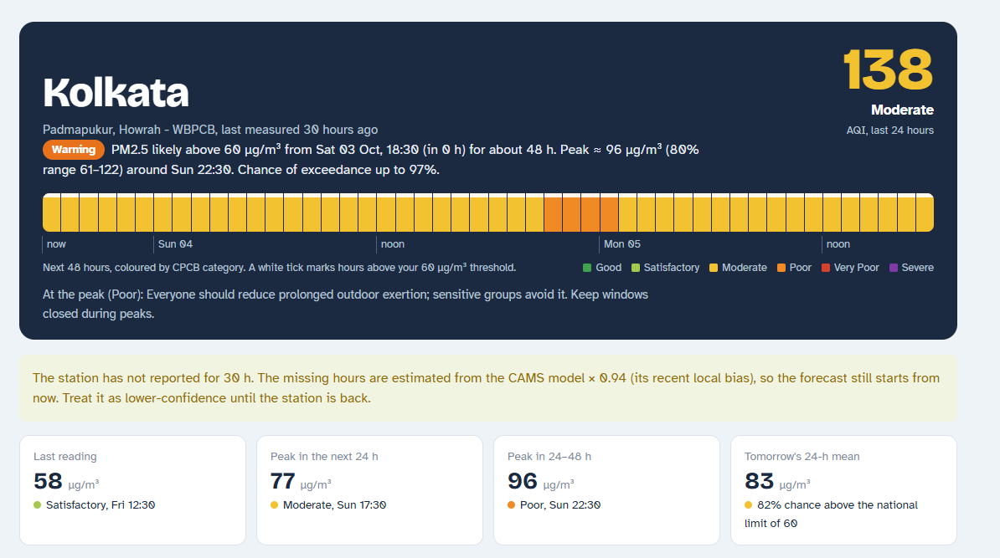
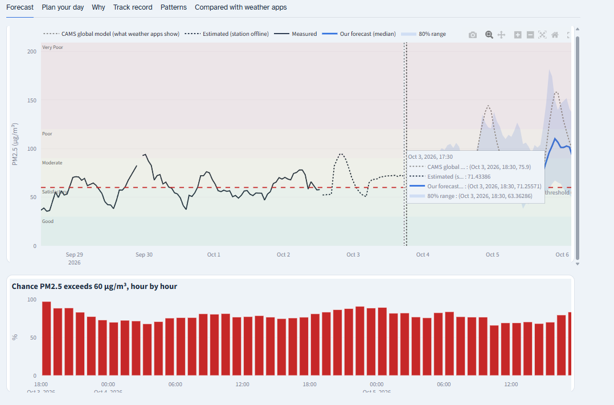
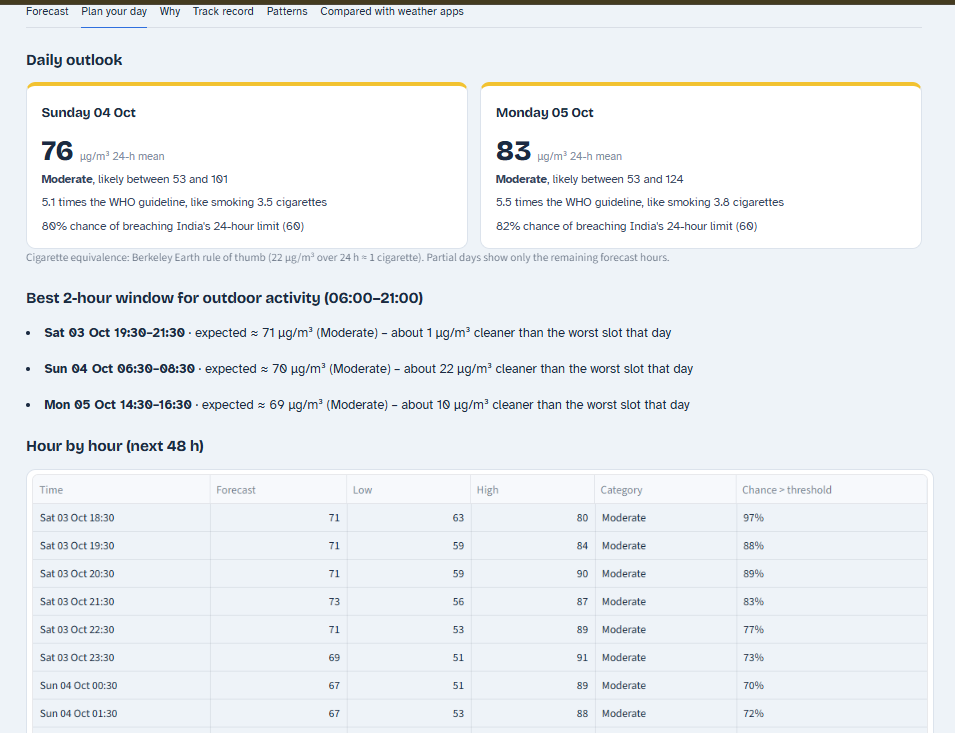
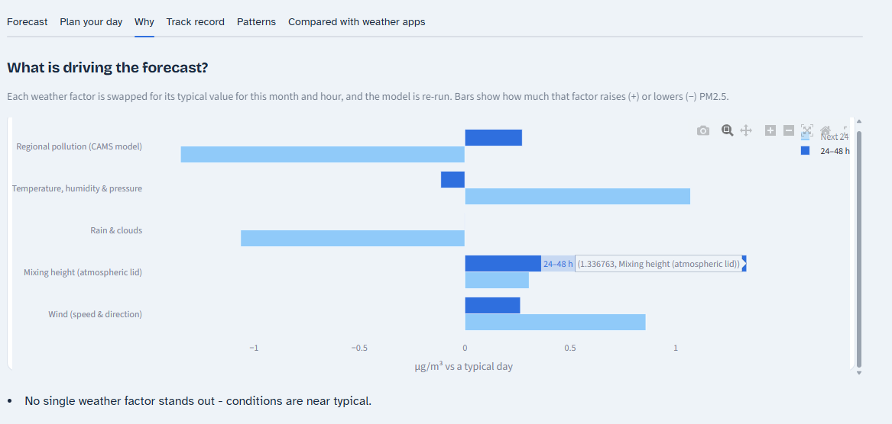
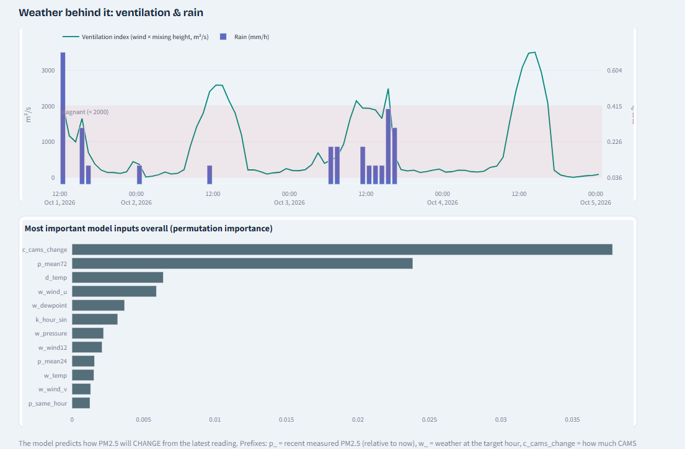
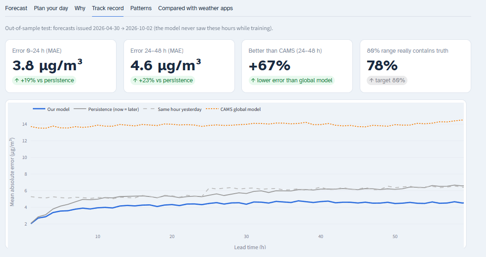
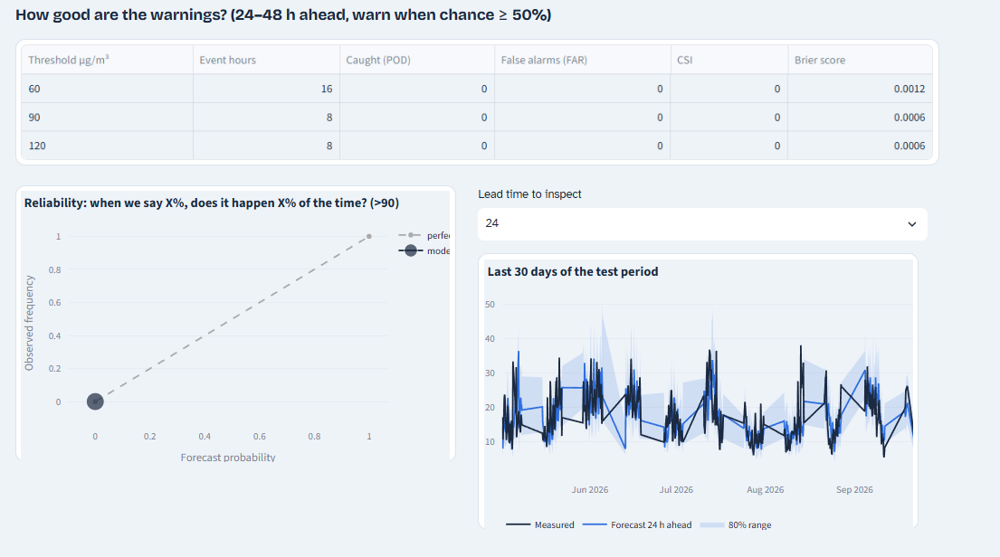
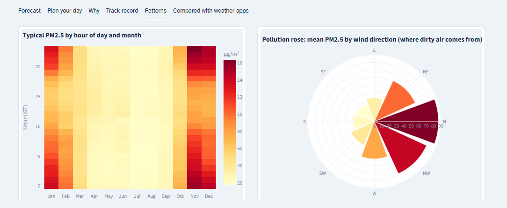
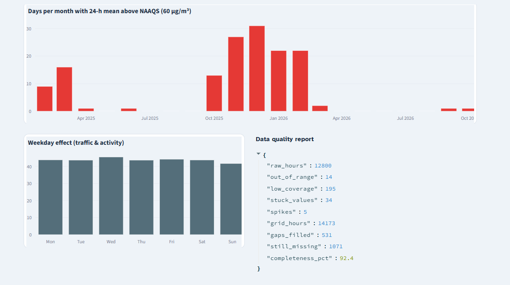
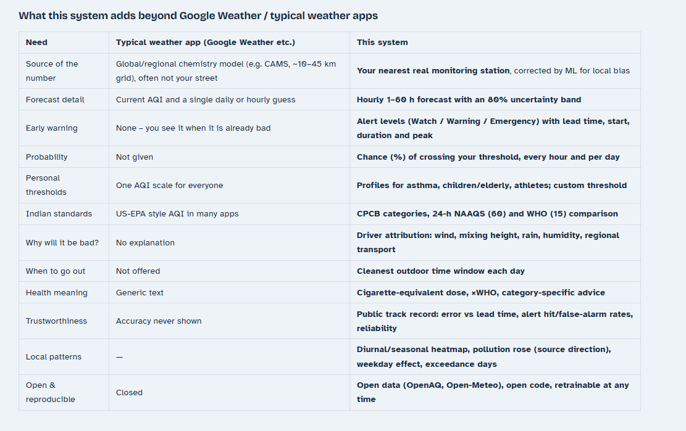

# Reading the Dashboard: A Beginner's Guide to Every Chart

This guide assumes **no background in climate science or geography**.

* **Part A** is a short crash course on the science behind the project: what PM2.5 is, why weather controls pollution, and what makes Kolkata special.
* **Part B** goes through the dashboard **chart by chart**, using your own screenshots from Saturday 3 October 2026. It explains what each element means, how to read it, and what it is telling you right now.
* **Part C** gives a short demo script and the questions examiners usually ask about the charts.

---

## Part A: The science you need, in plain words

### A1. What we are measuring: PM2.5
* **PM2.5** means *particulate matter* smaller than **2.5 micrometres**, about 1/30th of the width of a human hair. These particles are small enough to pass the nose and throat, reach deep into the lungs, and even enter the blood.
* **µg/m³** (micrograms per cubic metre) measures how much particle **mass** floats in one cubic metre of air. A microgram is a millionth of a gram. "60 µg/m³" means the particles in a 1 m × 1 m × 1 m box of air would weigh 60 millionths of a gram together.
* **Sources in and around Kolkata:**
  * vehicle exhaust
  * burning of wood, coal, garbage and crop residue
  * industry and brick kilns
  * road and construction dust
  * smoke from far away, carried in by the wind

  Some particles also form in the air itself, from gases reacting together ("secondary" aerosols), and this happens faster in humid air.
* **Limits:**
  * India's national standard (**NAAQS**) is **60 µg/m³** averaged over 24 hours.
  * The **WHO** guideline is much stricter: **15 µg/m³**.

### A2. Why the weather decides how polluted the air is
Think of the city as **a room with a smoky stove**:
* The **stove** is the emissions: traffic, cooking, burning. These are roughly similar every day.
* The **size of the room** is how much air the smoke can spread into.
* An **open window** is the wind carrying the smoke away.
* **Mopping the floor** is rain washing particles out of the air.

The same stove makes a small closed room very smoky, but a big airy room stays clean. **Weather changes the size of the room and how open the window is**, hour by hour. That is why we can forecast pollution from a weather forecast.

**Mixing height (boundary-layer height, "BLH"): the height of the room's ceiling.**
* **Daytime:** the sun heats the ground, warm air rises in bubbles and stirs the lowest part of the atmosphere. Pollution gets mixed up to **1,000–3,000 m**.
* **Night:** the ground cools, the stirring stops, and the mixed layer **collapses to 100–300 m**. The same emissions now sit in about **10 times less air**, so the concentration shoots up.
* **Inversion:** at night or in winter, a layer of warmer air can sit *above* cooler air near the ground. It acts like a lid and traps the pollution. Winter nights are the worst.

> This single effect explains most of the patterns in the charts: **high pollution at night and early morning, lowest in the afternoon, and much worse in winter.**

**Wind: the open window.**
* **Wind speed** (metres per second, m/s) is how fast air moves the pollution away. Below about 1–2 m/s the air is "stagnant" and pollution builds up.
* **Wind direction** is always given as **where the wind comes FROM** (a meteorology convention). A "north-west wind" blows *from* the north-west *towards* the south-east. This matters because the wind brings that region's air with it.
* **u and v components:** computers split the wind into an east–west part (**u**, positive when it blows towards the east, i.e. comes from the west) and a north–south part (**v**, positive when it blows towards the north, i.e. comes from the south). This avoids the problem that 359° and 1° are almost the same direction but look far apart as numbers.

**Ventilation index = wind speed × mixing height** (units m²/s). It combines the size of the room and the open window into one number: *how much air is available to flush the pollution away*.
* below about **2,000 m²/s**: stagnant air, pollution builds up
* daytime values of several thousand: well ventilated

**Rain** washes particles out of the air ("wet deposition"). Even light rain helps a little.

**Humidity and dew point.**
* Relative humidity is how close the air is to saturation, in %.
* The dew point is the temperature at which water would condense; a higher dew point means more moisture in the air.
* Humid air makes particles absorb water and grow, helps secondary particles form, and produces fog in winter, which traps pollution.

**Pressure.** High pressure usually means sinking, calm air (bad for pollution); low pressure means rising, unsettled air (better).

### A3. Kolkata's geography and seasons
* Kolkata sits at the **eastern end of the Indo-Gangetic Plain (IGP)**, the long flat plain stretching from Punjab through Delhi, Uttar Pradesh and Bihar to West Bengal. It is home to hundreds of millions of people and is **one of the most polluted regions on Earth**. To Kolkata's south lies the **Bay of Bengal**.
* **Winter (November–February):**
  * winds blow mostly from the **north and north-west**, down the plain, carrying its pollution (including crop-burning smoke in October–November) towards Kolkata
  * nights are cool with strong inversions and low mixing heights
  * there is almost no rain

  Result: **the dirtiest season**, often 100–200 µg/m³ at night.
* **Pre-monsoon (March–May):** hot days with deep mixing; moderate pollution, sometimes dust.
* **Monsoon (June–September):** winds from the **south and south-west** bring clean, humid **marine air from the Bay of Bengal**, and heavy rain washes the air. **The cleanest season**, often 10–30 µg/m³.
* **Post-monsoon (October):** the transition. Winds turn northerly, rain stops, and festival fireworks (Durga Puja, Kali Puja / Diwali) add spikes. Pollution starts climbing, which is where we are now (3 October).

### A4. Time zones: why the times end in ":30"
OpenAQ and the weather data use **UTC**, the world reference time. **India (IST) is UTC + 5:30.** The Kolkata stations report on the UTC hour, so in Indian time the readings fall at **12:30, 13:30, 18:30** and so on.

### A5. AQI is not the same as µg/m³
* **Concentration** (µg/m³) is the physical amount of particles.
* The **AQI** (Air Quality Index, 0–500) is a **score** that turns concentration into health categories. India's AQI comes from the **CPCB** (Central Pollution Control Board) and is defined on the **24-hour average**:

| PM2.5 24-h mean (µg/m³) | AQI | Category |
|---|---|---|
| 0–30 | 0–50 | Good |
| 31–60 | 51–100 | Satisfactory |
| 61–90 | 101–200 | Moderate |
| 91–120 | 201–300 | Poor |
| 121–250 | 301–400 | Very Poor |
| > 250 | 401–500 | Severe |

Inside each band the AQI rises in a straight line. **Example:** a 24-h mean of 71 µg/m³ lies in the 60–90 band, which maps to AQI 100–200:

$$\text{AQI} = 100 + \frac{71 - 60}{90 - 60}\times 100 \approx 137$$

That is the **AQI 138** shown in the header.

### A6. CAMS: what weather apps show
**CAMS** (Copernicus Atmosphere Monitoring Service) is a global computer simulation of the atmosphere run in Europe.
* It divides the world into grid boxes about **45 km wide** and simulates emissions, wind and chemistry.
* It is good at the big picture (for example, a polluted air mass moving down the plain), but it cannot see a single neighbourhood and is often biased.
* Google Weather and most apps show numbers like these. We use CAMS as **one input** and as **the benchmark to beat**.

### A7. Forecast words used on the dashboard

| Word | Meaning |
|---|---|
| **Median forecast** | The middle value: half the time reality will be higher, half the time lower |
| **80 % range** (band) | The interval between the 10th and 90th percentiles: in 8 out of 10 cases, the true value should fall inside it |
| **Probability / chance** | How likely it is that PM2.5 will be above your threshold in that hour |
| **Lead time** | How many hours ahead the forecast looks |
| **Persistence** | The simplest possible forecast: "it will stay as it is now" |
| **MAE** | Mean absolute error: on average, how many µg/m³ the forecast is off by |
| **Threshold** | The level you chose in the sidebar (60 µg/m³ in your screenshots) |

---

## Part B: Every chart, one by one

### B1. The header (dark box at the top)

Reading it from top-left to bottom-right:

1. **"Kolkata"** and **"Padmapukur, Howrah - WBPCB, last measured 30 hours ago"**:
   * The forecast is anchored to this monitoring station, run by the West Bengal Pollution Control Board (WBPCB).
   * "30 hours ago" means the station has not sent new data for 30 hours. This is a gap in the OpenAQ feed, not a fault in our app.
2. **"138 / Moderate / AQI, last 24 hours"** (top right): the India AQI computed from the **average of the last 24 hours** (about 71 µg/m³, see A5).
   * The number is coloured by its category (yellow = Moderate).
   * It includes the estimated hours while the station is silent.
3. **The orange "Warning" chip** is the warning level for *your* threshold (60 µg/m³, the "sensitive groups" profile):

   | Level | Rule |
   |---|---|
   | Clear | the chance of exceeding the threshold stays below 30 % in the next 48 h |
   | Watch | the chance reaches 30 % |
   | **Warning** | the chance reaches 60 % |
   | Emergency | the forecast peak is above 250 µg/m³ |

4. **The message**, decoded piece by piece:

   | Text | Meaning |
   |---|---|
   | *"PM2.5 likely above 60 µg/m³ from Sat 03 Oct, 18:30 (in 0 h)"* | It is already above the threshold right now |
   | *"for about 48 h"* | Every one of the next 48 hours has at least a 50 % chance of being above 60 |
   | *"Peak ≈ 96 µg/m³ (80 % range 61–122) around Sun 22:30"* | The highest expected hour is Sunday night: most likely 96, and 8 times out of 10 between 61 and 122 |
   | *"Chance of exceedance up to 97 %"* | The most certain hour is almost sure to be above 60 |

5. **The colour strip** is the next 48 hours, **one block per hour**, coloured by the forecast PM2.5 category.
   * Here it is almost all **yellow (Moderate, 61–90)**. A run of **orange (Poor, 91–120)** appears on **Sunday night**, which is the forecast peak.
   * **Why at night?** The mixing layer collapses after sunset (A2), trapping the day's emissions in a shallow layer.
   * **White ticks** on top mark hours above your threshold. Here every hour has one.
   * The labels under the strip ("now", "Sun 04", "noon", "Mon 05") are the time axis.
6. **"At the peak (Poor): …"** is the health advice for the category of the peak hour.

### B2. The yellow notice under the header
*"The station has not reported for 30 h. The missing hours are estimated from the CAMS model × 0.94 …"*

* The model needs a recent reading to start from.
* While the station is silent, we fill the missing hours with **CAMS multiplied by 0.94**. The 0.94 is learned from the last 7 days, when CAMS was running about 6 % higher than this station. That correction is the "local bias".
* The forecast therefore still starts from *now*, but it is **less certain** until real readings return.
* These estimates are **never used to train** the model.

### B3. The four tiles

| Tile | What it says here | How to read it |
|---|---|---|
| **Last reading: 58** (Satisfactory, Fri 12:30) | The last *real* measurement, from Friday 12:30 IST, before the outage | Why is the AQI 138 when this is only 58? The AQI uses the **24-hour average including the estimated hours** (about 71), and the AQI is a score, not µg/m³ (A5) |
| **Peak in the next 24 h: 77** (Moderate, Sun 17:30) | The highest hourly median forecast in the next 24 hours | |
| **Peak in 24–48 h: 96** (Poor, Sun 22:30) | The highest in the following day | The Sunday-night peak from the strip |
| **Tomorrow's 24-h mean: 83**, 82 % chance above 60 | Sunday's average | The national standard is set on the 24-hour average, so this is the official yardstick. An 82 % chance means a likely "non-compliant" day |

### B4. Forecast tab: the main chart

**Axes:**
* **x-axis:** date and time in IST.
* **y-axis:** PM2.5 in µg/m³.

**Coloured background bands:** the CPCB categories (Good at the bottom, then Satisfactory, Moderate, Poor, Very Poor), so you can see which category any point falls in.

**Lines:**

| Line | What it is | What it shows in your screenshot |
|---|---|---|
| **Solid black** | **Measured** PM2.5 at the station | 28 September to 2 October: values 35–95, with a clear **daily rhythm** (higher at night, lower in the afternoon) |
| **Dotted black** | **Estimated** while the station is offline (CAMS × 0.94) | 2–3 October. It follows CAMS's shape, which is why it has a bump around 95 |
| **Vertical dotted line** | **Now** | Saturday evening |
| **Solid blue** | **Our forecast (median)** | About 70 now, a dip during Sunday daytime, about 110 on Sunday night and Monday night |
| **Light-blue band** | **80 % range** | It **widens with time**: the further ahead, the less certain. Up to about 180 at the Monday-night peak |
| **Grey dotted** | **CAMS** (what weather apps show) | Much **spikier**: about 145 on Sunday night and about 158 on Monday night. Our model, trained on this station's history, expects less extreme peaks |
| **Red dashed** | **Your threshold** (60) | |

**Hover box:** moving the mouse over the chart shows every line's value at that time, for example *"Our forecast … 71.26; 80 % range … 63.36"*.

**What to say:** "The blue line is our forecast, with its uncertainty band. The grey line is what a typical weather app would show. Both expect night-time peaks, because the atmosphere's mixing layer collapses after sunset, but our model is calibrated to this station."

### B5. Forecast tab: "Chance PM2.5 exceeds 60 µg/m³, hour by hour"
* **One bar per hour** for the next 48 hours. The height is the **probability (%)** that PM2.5 will be above your threshold in that hour.
* **Colours:** red ≥ 60 %, amber 30–60 %, grey below 30 %.
* **Here every bar is red (65–97 %)**, because the median forecast (about 70) sits above 60 most of the time.
* The bars **dip in the afternoons** (about 65–70 %), when the mixing layer is deepest, and **rise at night** (about 85–90 %). This is the daily rhythm again.
* The first bar (97 %) is high because the starting value is already well above 60 and close in time, so there is little uncertainty.

### B6. Plan your day tab

**Daily outlook cards** (Sunday and Monday). Today has no card, because fewer than 12 hours of Saturday remain.

| Line on the card | Meaning (Sunday card) |
|---|---|
| **76 µg/m³ 24-h mean** | The forecast average for the whole day |
| **Moderate, likely between 53 and 101** | The day's 80 % range (a slightly wide, conservative estimate) |
| **5.1 times the WHO guideline** | 76 ÷ 15 |
| **like smoking 3.5 cigarettes** | 76 ÷ 22. A rule of thumb from Berkeley Earth: breathing 22 µg/m³ for 24 hours harms the body about as much as smoking one cigarette. A way to make the number meaningful to non-experts |
| **80 % chance of breaching India's 24-hour limit (60)** | How likely the day's average is to be above 60 |

The coloured line on top of each card is the category colour.

**Best 2-hour window for outdoor activity (06:00–21:00).** For each day it finds the 2-hour slot with the **lowest forecast**, and says how much cleaner it is than the **worst** slot that day. The window length can be changed in the sidebar.
* **Sun 04 Oct 06:30–08:30, about 70, about 22 µg/m³ cleaner than the worst slot.** The best time on Sunday is early morning, before the evening build-up.
* **Mon 05 Oct 14:30–16:30, about 69.** The afternoon, when mixing is deepest.
* **Sat 03 Oct 19:30–21:30, "about 1 µg/m³ cleaner".** Only a couple of hours of Saturday's window remain, so there is almost no choice.

**Hour by hour table.**
* **Columns:** Time (IST), Forecast (median), Low (10th percentile), High (90th percentile), Category, and the chance of exceeding the threshold.
* The **Download forecast (CSV)** button saves the full forecast.

### B7. Why tab: "What is driving the forecast?"

**How it is calculated (a "what if" test):**
1. For each weather factor, the model is re-run with that factor replaced by its **typical value for this month and hour**, the station's own long-term October average at that time of day.
2. The difference between the real forecast and the "typical" one is that factor's **effect**.

**How to read it:**
* **Bars to the right (+)**: this factor is making the air *worse* than on a normal October day.
* **Bars to the left (−)**: this factor is making the air *better* than normal.
* **Light blue** = next 24 hours; **dark blue** = 24–48 hours.
* **x-axis:** µg/m³ difference.

**In your screenshot, all effects are tiny (within ±1.5 µg/m³):**
* **Regional pollution (CAMS):** −1.4 in the next 24 h. The regional model expects slightly cleaner incoming air than usual.
* **Rain & clouds:** about −1. Some showers lower PM a little.
* **Temperature, humidity & pressure:** about +1.
* **Wind:** about +0.9. Slightly calmer than usual.
* **Mixing height:** +0.3 to +1.3.

Hence the sentence **"No single weather factor stands out: conditions are near typical."** The high values come from the **season** (early October, pollution rising) and the **current level**, not from unusual weather. On a real stagnation episode, such as a calm winter week, you would see bars of +10 to +30.

### B8. Why tab: "Weather behind it: ventilation & rain"

* **Green line:** the **ventilation index** (wind × mixing height, left axis, m²/s); see A2.
* **Pink shaded zone below 2,000:** "stagnant" air.
* **Blue bars:** rain in mm per hour (right axis). Values of 0.04–0.6 are light rain.

**How to read it:**
* The green line has a clear **daily pulse**. It peaks around **noon (2,500–3,500)**, when the sun stirs the air and the mixing layer is deep, and drops to **100–300 at night**, deep in the stagnant zone.
* **Every night is stagnant.** That is exactly why the forecast and the strip peak at night.
* The light rain on **1 and 3 October** helped keep values moderate.
* Sunday has a good daytime peak but a very low night (about 100), which matches the **Sunday-night forecast peak**.

### B9. Why tab: "Most important model inputs overall (permutation importance)"
**How it is calculated:** on the test data, each input is **shuffled randomly** one at a time, breaking its link with the target, and the increase in the model's error is measured. The bigger the increase, the more the model relies on that input. This chart is about the model **in general**, not today's forecast.

| Input | Plain meaning | Why it matters |
|---|---|---|
| `c_cams_change` | How much the CAMS regional model expects PM2.5 to **change** between now and the target hour | Captures polluted or clean air masses arriving from the region (transport down the Indo-Gangetic Plain) |
| `p_mean72` | The average of the last 3 days relative to the current reading | If the current level is far from the recent average, pollution tends to drift back towards it |
| `d_temp` | Temperature change from now to the target hour | Cooling (evening, night) means a collapsing mixing layer and rising PM. Warming (morning) means mixing and falling PM |
| `w_wind_u` | The east–west wind component (A2) | In Kolkata, air from the west/north-west (inland, polluted) versus the east (cleaner) |
| `w_dewpoint` | Moisture in the air | Humid air: particle growth, fog, secondary particles |
| `k_hour_sin` | Time of day (encoded as a smooth circle) | Traffic peaks and the daily mixing cycle |
| `w_pressure` | Air pressure | High pressure: calm, sinking air |
| `w_wind12` | Average wind speed over the last 12 hours | Has the air been stagnant for a while? |
| `p_mean24` | 24-hour average relative to now | Yesterday's level |
| `w_temp` | Temperature at the target hour | Cold nights mean strong inversions |
| `w_wind_v` | The north–south wind component | North (inland) versus south (Bay of Bengal, clean) |
| `p_same_hour` | PM2.5 at the same clock hour on the last observed day | The daily rhythm |

**Prefixes:** `p_` = past PM2.5, `w_` = weather, `c_` = CAMS, `d_` = change between now and the target hour, `k_` = calendar.

### B10. Track record tab: the four tiles

These numbers come from the **backtest**: the model was tested on **30 April to 2 October 2026**, a period it **never saw during training**, as if it had been forecasting live.

| Tile | Meaning |
|---|---|
| **Error 0–24 h: 3.8 µg/m³** (+19 % vs persistence) | For forecasts up to a day ahead, the model is off by 3.8 µg/m³ on average. That is **19 % less** error than "it stays as it is now" |
| **Error 24–48 h: 4.6 µg/m³** (+23 %) | For day-2 forecasts: 23 % better than persistence |
| **Better than CAMS (24–48 h): +67 %** | Our error is **two-thirds smaller** than the CAMS model's (about 14 µg/m³) |
| **80 % range really contains truth: 78 %** | The uncertainty band is honest: it was promised to hold the truth 80 % of the time and does so 78 % of the time |

### B11. Track record: "Mean absolute error by lead time"
* **x-axis:** lead time, 1 to 60 hours ahead.
* **y-axis:** average error (µg/m³); **lower is better**.

| Line | Shape | Meaning |
|---|---|---|
| **Blue, our model** | Starts at about 2, rises slowly to about 4.5 | The best line at almost every lead time |
| **Grey solid, persistence** | Starts at about 2, rises to about 6.5 | "No change" is good at 1 hour but gets worse quickly |
| **Grey dashed, same hour yesterday** | About 5–6, with a **jump at 24 h** | Beyond 24 h it must use the day *before* yesterday, so it gets worse |
| **Orange dotted, CAMS** | Flat at about **14** | CAMS's error barely depends on lead time. It is dominated by a constant **bias** at this station (it is systematically off), which is exactly what a station-trained model removes |

**At 1 hour the blue and grey lines meet.** Nothing beats "the same as an hour ago" over one hour, and the model is designed to stay close to it there.

### B12. Track record: "How good are the warnings?"

* **Event hours:** how many hours in the test period were really above the threshold, at 24–48 h lead time.
* **Caught (POD):** the share of those hours that had been warned about.
* **False alarms (FAR):** the share of warnings that turned out wrong.
* **CSI:** a combined score (1 = perfect).
* **Brier score:** the error of the probabilities; 0 is perfect.

**Why does it show 0, 0, 0?** The test period was **May–September, the monsoon**, when Kolkata's air is cleanest. There were only **16 hours above 60** (and 8 above 90) in the whole period. The model gave a ≥ 50 % chance for none of those few hours, so POD = 0, and it raised no warnings at all, so FAR = 0. The tiny Brier scores (0.0012) only say "it correctly said *no* almost all the time".

> **What to say in the demo:** "The warning statistics need a polluted season in the test period. Our current data have only one winter, which was used for training. When this winter's data arrive, retraining will give a meaningful hit rate. The error charts are already meaningful."

### B13. Track record: the reliability diagram
* It asks: **"When the model says X % chance, does it happen X % of the time?"**
* Forecasts are grouped by their probability (0–10 %, 10–20 %, …). For each group, the actual frequency of PM2.5 > 90 is plotted.
* **A perfect model lies on the dashed diagonal.**
* **Here there is a single dot at (0, 0).** In the monsoon test period almost every forecast said about 0 % and it indeed never happened, so only one group has enough cases. It becomes a proper curve once winter data are in the test set.

### B14. Track record: "Last 30 days of the test period"
* **Black:** measured PM2.5. **Blue:** what the model had forecast **24 hours earlier** (change the lead time with the box above it). **Band:** the 80 % range.
* When the blue line follows the black one, the forecast worked.
* **Note:** your screenshot shows June–September (about 4 months). The title said 30 days, but the chart was really taking the last 720 rows, and rows exist only every 3rd hour. I've fixed it to show the true last 30 days (see the end of this guide).
* **The long straight segments** in your screenshot are not data: they are **jumps across gaps**. The test period alternates weeks: one week is used to calibrate the model and the next week to score it, and only scored weeks are plotted. The fixed chart breaks the line at these gaps.

### B15. Patterns tab: "Typical PM2.5 by hour of day and month" (heatmap)

* **x-axis:** month (Jan–Dec). **y-axis:** hour of the day (IST, 0 = midnight). **Colour:** the average PM2.5 for that month and hour, from pale yellow (about 20) to dark red (about 160).
* **Reading across (seasons):**
  * **November–January** are dark red: the winter peak, with northerly winds from the plain, inversions and no rain.
  * **June–September** are pale: the monsoon, with clean sea air and rain.
  * **October and February–March** are in between: the transition seasons.
* **Reading down (daily cycle):** in winter, the **night and early-morning hours (20:00–08:00) are darkest**, and **13:00–16:00 is lightest**. That is the mixing-height cycle from A2.
* **Takeaway:** the worst exposure is a winter night or early morning; the cleanest is a monsoon afternoon.

### B16. Patterns tab: the pollution rose
* **The direction of each wedge** is where the wind was coming **from** (A2). **The length of the wedge** is the average PM2.5 when the wind came from that direction.
* **Wind from the N and NW: longest wedges (about 80–90 µg/m³).** That air travels over the **Indo-Gangetic Plain**, the heavily populated, polluted land to Kolkata's north-west, and these are the **winter** winds.
* **Wind from the S, SW and SE: shortest wedges (about 20–40).** That is **marine air from the Bay of Bengal**, typical of the monsoon.
* **Caveat:** wind direction and season go together (winter brings NW winds), so part of the difference is the season itself, not only the source region.
* **⚠️ Note about your screenshot:** in that version the compass was **rotated**, with N drawn on the right and E at the top (the chart library's default for circular charts). I've fixed it so **N is at the top and E on the right**, like a normal map. The data are the same; only the drawing changes.

### B17. Patterns tab: "Days per month with 24-h mean above NAAQS (60 µg/m³)"

* Each bar counts the **days in that month** whose 24-hour average broke India's standard.
* **Winter 2025–26:**

  | Month | Days above 60 |
  |---|---|
  | October 2025 | 13 |
  | November 2025 | 27 |
  | December 2025 | **31** (every single day) |
  | January 2026 | 22 |
  | February 2026 | 22 |

* **March 2025** shows 16 days. February 2025 is short because this station's data begin in mid-February 2025.
* **The monsoon months show 0**, and September and October 2026 show one day each. **The pollution season is starting now.**

### B18. Patterns tab: "Weekday effect (traffic & activity)"
* The average PM2.5 for each day of the week.
* **Nearly flat (about 42–46)**, with Sunday slightly lower.
* **Meaning:** in Kolkata, the day of the week matters much less than **weather and season**. Traffic changes on weekends are small compared with the effect of the mixing layer and wind.

### B19. Patterns tab: data quality report
The raw station data are cleaned before use. These numbers say what happened:

| Field | Value | Meaning |
|---|---|---|
| `raw_hours` | 12,800 | Hourly readings downloaded |
| `out_of_range` | 14 | Impossible values (≤ 0 or > 1,000) removed |
| `low_coverage` | 195 | Hours built from too few sub-hourly readings (below 50 %) removed |
| `stuck_values` | 34 | The same value repeated for 6 or more hours (a frozen sensor) removed |
| `spikes` | 5 | One-off glitches (more than 4 times the local median and above 250) removed |
| `grid_hours` | 14,173 | Hours on the complete timeline from the first to the last reading |
| `gaps_filled` | 531 | Short gaps (≤ 3 h) filled by straight-line interpolation |
| `still_missing` | 1,071 | Longer gaps left empty, rather than invented |
| `completeness_pct` | 92.4 | 92.4 % of hours have a value |

### B20. "Compared with weather apps" tab

A summary table of what this system adds beyond Google Weather. Every row maps to something you saw above:

| Row | Where you saw it |
|---|---|
| Local station and calibration | B4, B11 |
| Hourly forecast with a band | B4 |
| Warning levels | B1 |
| Probabilities | B5 |
| Personal thresholds | Sidebar |
| Indian standards | B1, B6 |
| Explanations | B7–B9 |
| Best time to go out | B6 |
| Health meaning | B6 |
| Track record | B10–B14 |
| Local patterns | B15–B18 |

---

## Part C: Using this in your demo

### C1. A 3-minute walk-through
1. **Header** (30 s): "Kolkata, nearest official monitor. Right now the AQI is 138, Moderate. The model issues a **Warning** for sensitive groups: above 60 for most of the next two days, peaking on Sunday night. Each block of the strip is one hour."
2. **Forecast tab** (45 s): "Black is measured, blue is our forecast with its 80 % band, grey is what weather apps show. The peaks at night happen because the atmosphere's mixing layer collapses after sunset and traps pollution."
3. **Why tab** (30 s): "The ventilation index, wind times mixing height, drops into the stagnant zone every night. Today no factor is unusual; in winter these bars become large."
4. **Track record** (45 s): "Tested on five months it never saw: 19–23 % better than persistence and about two-thirds less error than CAMS. The band is honest, at 78 % against a target of 80 %. Warning statistics need a winter in the test set."
5. **Patterns** (30 s): "Winter nights are worst, monsoon afternoons cleanest. Polluted air arrives with north and north-west winds from the Indo-Gangetic Plain, and clean air from the Bay of Bengal."

### C2. Questions examiners often ask about the charts

**Why is the AQI 138 when the last reading is 58?**
The AQI is defined on the 24-hour average (about 71 µg/m³ here, including the estimated hours) and is a different scale from µg/m³.

**Why is pollution highest at night?**
After sunset the ground cools and the mixed layer of air shrinks from about 1–2 km to about 100–300 m. The same emissions then sit in a much smaller volume of air.

**What is the ventilation index?**
Wind speed × mixing height: how much air is available to flush pollution away. Below about 2,000 m²/s the air is stagnant.

**Why is the CAMS error flat at about 14?**
CAMS is a coarse global model with a systematic bias at this location. Its error comes mainly from that bias, not from forecasting further ahead.

**Why are the warning scores zero?**
The test period was the monsoon, with only 16 polluted hours. They become meaningful after retraining with winter data in the test period.

**What does the pollution rose show?**
Where the dirtiest air comes from: north and north-west, along the Indo-Gangetic Plain, mostly in winter.

**Why does the band widen?**
Uncertainty grows the further ahead we forecast, because the weather forecasts themselves become less certain.

**Is the station offline a problem?**
The feed sometimes stops. We bridge gaps of up to 14 days with a bias-corrected CAMS estimate, flag it clearly, and never train on it.

---

## Changes made while writing this guide
Two charts in your screenshots were misleading, so I fixed them in both the full project and the checkpoint-2 build:
1. **Pollution rose orientation:** now N is at the top and directions run clockwise, like a compass.
2. **"Last 30 days of the test period":** it now really shows the last 30 days, and breaks the line across calibration-week gaps instead of drawing straight lines through them.
